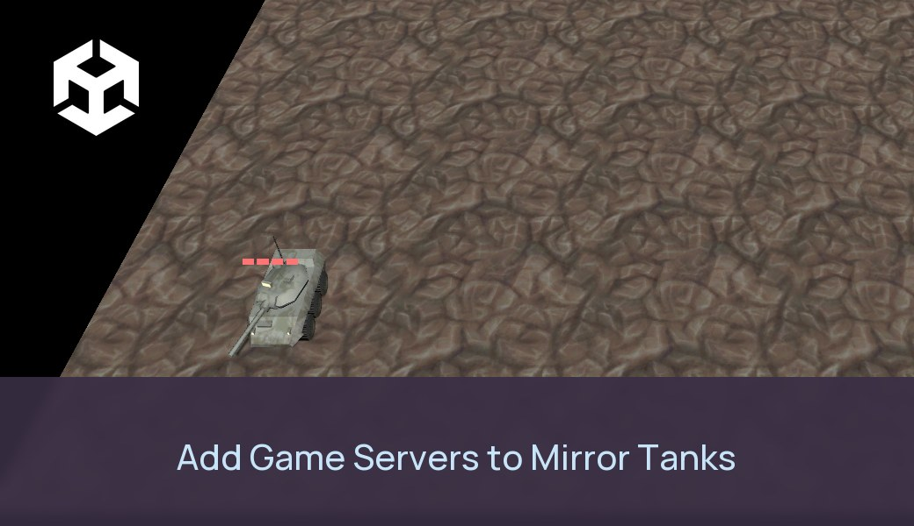

# Mirror Netcode on Edgegap

This sample puts a headless dedicated server for Mirror's `Tanks` example on Edgegap. The project already contains the Edgegap Unity plugin, so you build, containerize and upload the server from the Unity Editor.

Full documentation: [Mirror Tanks on Edgegap](https://docs.edgegap.com/docs/sample-projects/mirror-on-edgegap).

For a Mirror sample with a browser (WebGL) client and matchmaking, see [netcode-game-sample-webgl-mirror-tanks](https://github.com/edgegap/netcode-game-sample-webgl-mirror-tanks).

## Requirements

- Unity 2021.3 LTS with the **Linux Build Support** and **Linux Dedicated Server Build Support** modules
- Git (Unity fetches the Edgegap plugin from GitHub)
- Docker Desktop, running
- An [Edgegap](https://app.edgegap.com) account

## Build and deploy the server

1. Open the project in Unity 2021.3 or later. The scene `Assets/Mirror/Examples/Tanks/Scenes/Scene.unity` is the only scene in the build.
2. Open **Tools > Edgegap Server Hosting**, sign in, then use the steps from top to bottom: **Build server** (Linux Dedicated Server, written to `Builds/EdgegapServer`), **Containerize with Docker**, then **Upload image and create app version** (this pushes to the Edgegap registry).
3. In the Edgegap dashboard, create the application version with one port: **32114**, protocol **UDP** (the KCP transport port set on the `NetworkManager`). If you change the port on the `NetworkManager`'s Transport component, use the same value here.
4. Deploy the version. When the deployment is `Ready`, the **Port Mapping** tab shows the external port mapped to 32114.

The server starts by itself (`Auto Start Server Build` is on in the `NetworkManager`), so no start script is needed.

## Connect a client

1. Open the scene in the Editor and select the `NetworkManager` object.
2. Set **Network Address** to the deployment's FQDN (or public IP) and the Transport **Port** to the external port from **Port Mapping**.
3. Press Play, then **Client** in the Mirror HUD. Your tank spawns on the Edgegap server.

Stop the deployment from the dashboard when you are done.
